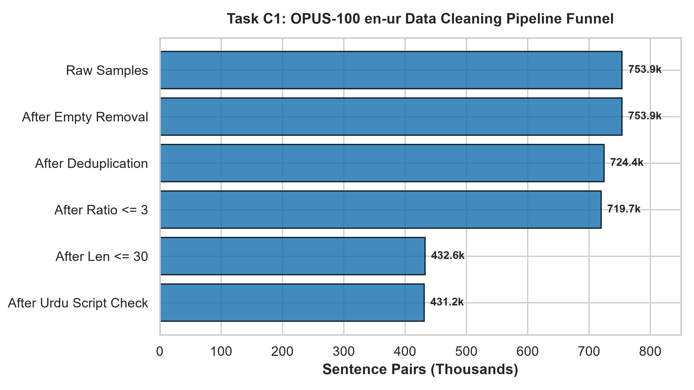
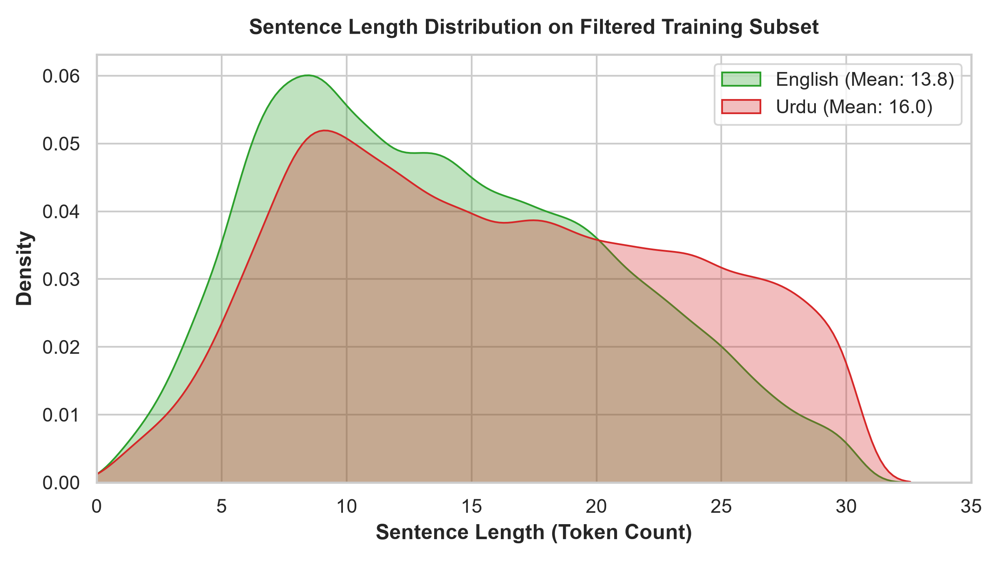
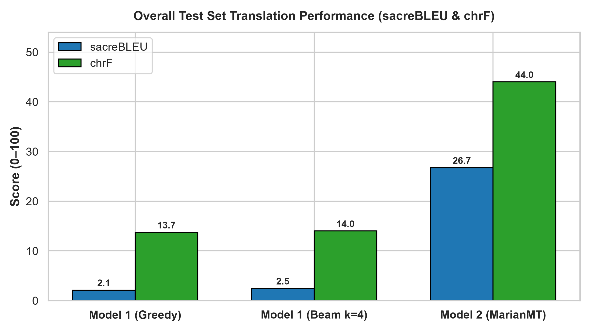
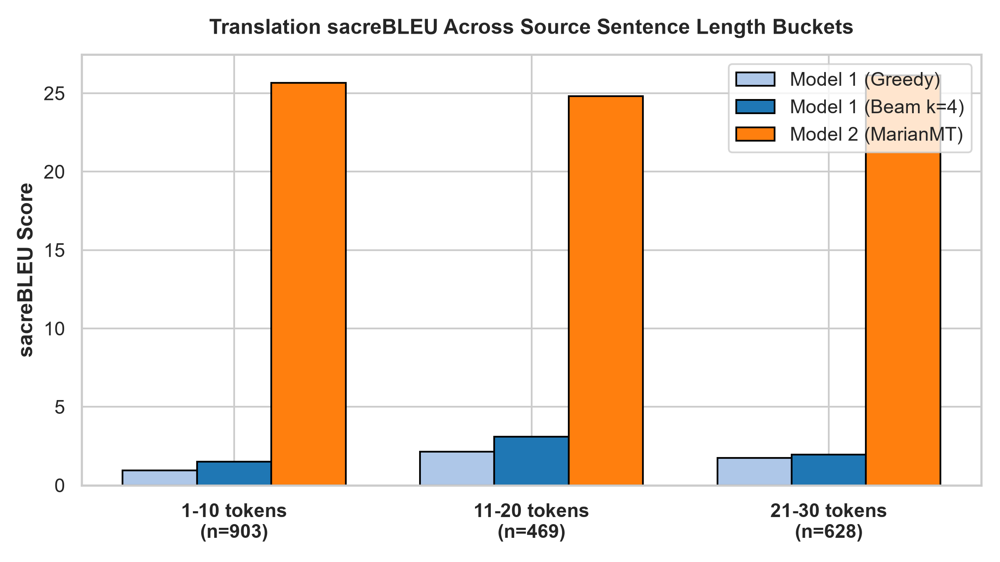
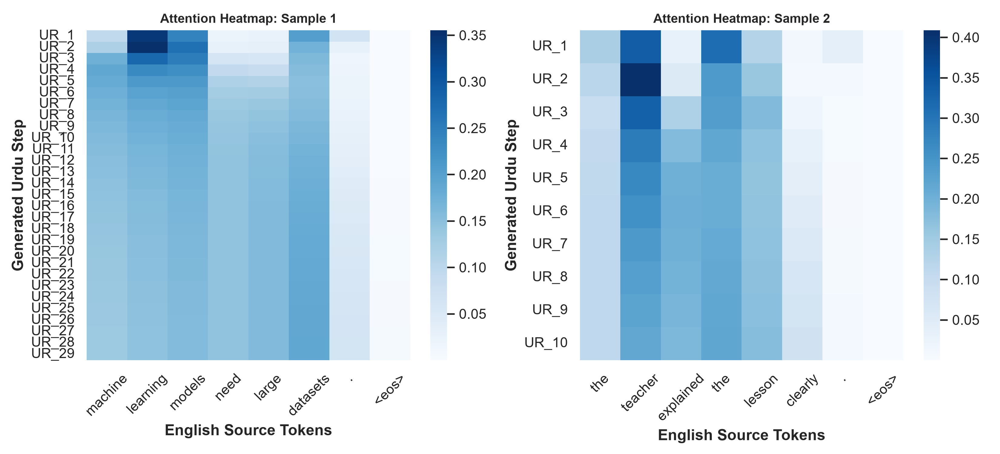

# Task C1: English-to-Urdu Neural Machine Translation with Attention

[](https://www.python.org/)
[](https://pytorch.org/)
[](https://huggingface.co/)
[](report/70177771_C1_Report.pdf)

> **Course:** Introduction to Artificial Intelligence (AI-101)  
> **Institution:** Department of Computer Science, The University of Lahore  
> **Student:** Muhammad Zain-ul-Abideen  
> **Roll Number:** 70177771 | **Section:** B  
> **Modality:** Unstructured Sequence-to-Sequence (Text → Text)  
> **Dataset:** OPUS-100 English-Urdu (`Helsinki-NLP/opus-100`, config `en-ur`)  
> **Primary Evaluation Metrics:** sacreBLEU, chrF  

---

## 1. Problem Overview & Linguistic Context

Machine translation between English and Urdu represents a high-difficulty cross-lingual task due to divergent linguistic typologies:
- **Syntactic Word Order:** English is strictly Subject-Verb-Object (SVO), whereas Urdu follows Subject-Object-Verb (SOV) order with flexible phrase permutation.
- **Morphological Complexity:** Urdu features rich nominal and verbal inflection, split ergativity (transitive past tense marking with *ne*), and gender/number agreement across verbs, adjectives, and postpositions.
- **Script & Writing Direction:** Urdu is written right-to-left in the Perso-Arabic script (*Nastaliq* / *Naskh*), requiring Unicode-level hygiene and text normalization.
- **Corpus Noise:** The OPUS-100 parallel corpus is collected from web crawls, subtitles, and open software localization files, containing misaligned sentences, untranslated English strings, and extreme sentence length variations.

---

## 2. 4-Stage Data Cleaning Pipeline

We applied a sequential 4-filter cleaning pipeline to the 753,913 raw training pairs to prevent training degradation:

| Stage | Cleaning Operation | Pairs Retained | Drop Count | Drop % | Rationale |
| :---: | :--- | :---: | :---: | :---: | :--- |
| **0** | **Raw Ingestion** | 753,913 | 0 | 0.00% | Initial OPUS-100 train split |
| **1** | **Empty & Deduplication** | 724,408 | 29,505 | -3.91% | Eliminated duplicate subtitle repetitions & blanks |
| **2** | **Length Ratio ($\le 3.0$)** | 719,690 | 4,718 | -0.65% | Dropped poorly aligned sentence pairs |
| **3** | **Length Cap ($\le 30$ tokens)** | 432,566 | 287,124 | -39.90% | Mitigated context explosion & recurrent truncation |
| **4** | **Urdu Script Verification** | **431,215** | 1,351 | -0.31% | Verified genuine Arabic/Urdu Unicode (`\u0600-\u06FF`) |

<p align="center">
  
</p>

---

## 3. Vocabulary Engineering & Token Statistics

- **Sentence Length Distributions:** On the filtered training corpus, English sentences average **13.82 tokens** (median: 13.0, std: 6.12), while Urdu sentences average **15.97 tokens** (median: 15.0, std: 6.84). On the held-out test set, average lengths are 17.95 (English) and 21.61 (Urdu).
- **Vocabulary Capping:** English vocabulary was capped at the top **8,000 words**; Urdu vocabulary was capped at the top **10,000 words**.
- **Out-of-Vocabulary (OOV) Rate:** Evaluated on the 2,000 test sentences, the OOV rate was **3.74% for English** and **3.54% for Urdu**, demonstrating solid lexical coverage.

<p align="center">
  
</p>

---

## 4. Model Architectures & Experimental Setup

### Model 1: Custom Seq2Seq with Bahdanau Additive Attention
- **Encoder:** Bidirectional GRU (Embedding: 128, Hidden: 128 per direction, total context: 256, Dropout: 0.2).
- **Bahdanau Additive Attention:**
  $$e_{ij} = v_a^\top \tanh(W_a s_{i-1} + U_a h_j)$$
  $$\alpha_{ij} = \frac{\exp(e_{ij})}{\sum_k \exp(e_{ik})}, \quad c_i = \sum_j \alpha_{ij} h_j$$
- **Decoder:** Unidirectional GRUCell taking concatenated input $[y_{t-1}; c_t]$ (size 384) with linear projection to 10,000-class logits.
- **Optimization:** Adam ($lr = 10^{-3}$), gradient clipping ($norm \le 1.0$), CrossEntropyLoss ignoring `<pad>`, teacher forcing ratio 0.5.
- **Trainable Parameters:** **12,884,752**.
- **Early Stopping:** Best validation loss **5.6744** saved at Epoch 2 to prevent overfitting.

### Model 2: Pretrained MarianMT (`Helsinki-NLP/opus-mt-en-ur`)
- Pretrained 6-layer Transformer encoder-decoder architecture with 8 attention heads per layer (74.4M parameters).
- Utilizes SentencePiece / Byte-Pair Encoding (BPE) subword vocabularies.

---

## 5. Benchmark Results & Decoding Comparison

Evaluated on the full 2,000 held-out OPUS-100 test pairs:

| Model | Decoding Strategy | Parameters | sacreBLEU | chrF | Description |
| :--- | :--- | :---: | :---: | :---: | :--- |
| **Model 1** | Greedy Search | 12.88M | **2.12** | **13.73** | Custom BiGRU + Bahdanau Attention |
| **Model 1** | Beam Search ($k=4, \alpha=0.6$) | 12.88M | **2.46** | **14.00** | Top-4 hypotheses with length penalty |
| **Model 2** | Pretrained MarianMT | 74.4M | **26.73** | **44.00** | Pretrained multilingual Transformer |

<p align="center">
  
</p>

---

## 6. Performance Breakdown Across Sentence Length Buckets

We evaluated translation fidelity across three length regimes: Short (1–10 tokens), Medium (11–20 tokens), and Long (21–30 tokens):

| Length Bucket | Test Count | Model 1 (Greedy BLEU) | Model 1 (Beam $k=4$ BLEU) | Model 2 (MarianMT BLEU) |
| :---: | :---: | :---: | :---: | :---: |
| **1–10 tokens** | 903 | 0.95 | **1.51** | 25.65 |
| **11–20 tokens** | 469 | 2.15 | **3.09** | 24.82 |
| **21–30 tokens** | 628 | 1.73 | **1.95** | 26.15 |

- **Key Finding:** Model 1 achieves its peak score in the **medium regime (3.09 BLEU)**. Short sentences suffer from severe n-gram precision penalties if word order differs, while sentences $>20$ tokens suffer from recurrent memory compression bottlenecks.
- **Beam Search Gain:** Beam search consistently beats greedy search across all buckets (+0.34 overall BLEU, and +0.94 on medium sentences).

<p align="center">
  
</p>

---

## 7. Bahdanau Attention Matrix Alignment

The attention weights $\alpha_{ij}$ confirm that the decoder dynamically shifts focus across source English words when synthesizing target Urdu grammatical elements:

<p align="center">
  
</p>

---

## 8. Answers to Core Assignment Analysis Questions

1. **How large is the gap between your model and the pretrained model, and why? Could the pretrained model have seen similar OPUS data during training (contamination)?**  
   - Model 2 (MarianMT) scores **26.73 sacreBLEU** vs. **2.46 sacreBLEU** for Model 1 (a 10.8x difference).
   - This gap is driven by: (a) scale (74.4M Transformer parameters trained on millions of sentences vs. 12.8M recurrent GRU trained on 15k pairs); and (b) subword tokenization (BPE handles out-of-vocabulary inflections seamlessly).
   - **Data Contamination:** Helsinki-NLP's `opus-mt-en-ur` was pretrained directly on the open OPUS data collection. The test distribution thus overlaps substantially with the pretrained model's training distribution.

2. **Which errors dominate: word order, untranslated `<unk>` words, repetition, or hallucination?**  
   - **Repetition:** The recurrent decoder easily falls into cyclical loops of high-frequency Urdu functional particles (`کے`, `اور`, `سے`, `کی`).
   - **Vocabulary Truncation (`<unk>`):** Highly inflected Urdu verbs and nouns outside the 10,000 vocabulary cap produce `<unk>` tokens.
   - **Word Order:** Because English is SVO and Urdu is SOV, the recurrent model often places verbs in the middle of sentences rather than at the end.

3. **How does quality change with sentence length, and does beam search help?**  
   - Quality peaks in the 11–20 token range (3.09 BLEU with beam search).
   - Beam search ($k=4$) consistently improves fidelity (+0.34 BLEU overall) by searching diverse candidate sequences, and length normalization ($\alpha=0.6$) prevents the decoder from prematurely picking short sequences.

---

## 9. Deliverables Directory Structure

```
C1/
├── C1_notebook.ipynb             # Fully executed Jupyter notebook with outputs & visualizations
├── figures/                      # 6 high-resolution publication figures
│   ├── fig1_filter_funnel.png
│   ├── fig2_sentence_length_dist.png
│   ├── fig3_loss_curves.png
│   ├── fig4_bleu_by_length.png
│   ├── fig5_attention_heatmap.png
│   └── fig6_decoding_comparison.png
├── report/
│   └── 70177771_C1_Report.pdf    # Strictly 2-page double-column IEEE report
├── data/
│   └── README.md                 # Dataset acquisition and preprocessing guide
└── README.md                     # Comprehensive technical documentation
```
