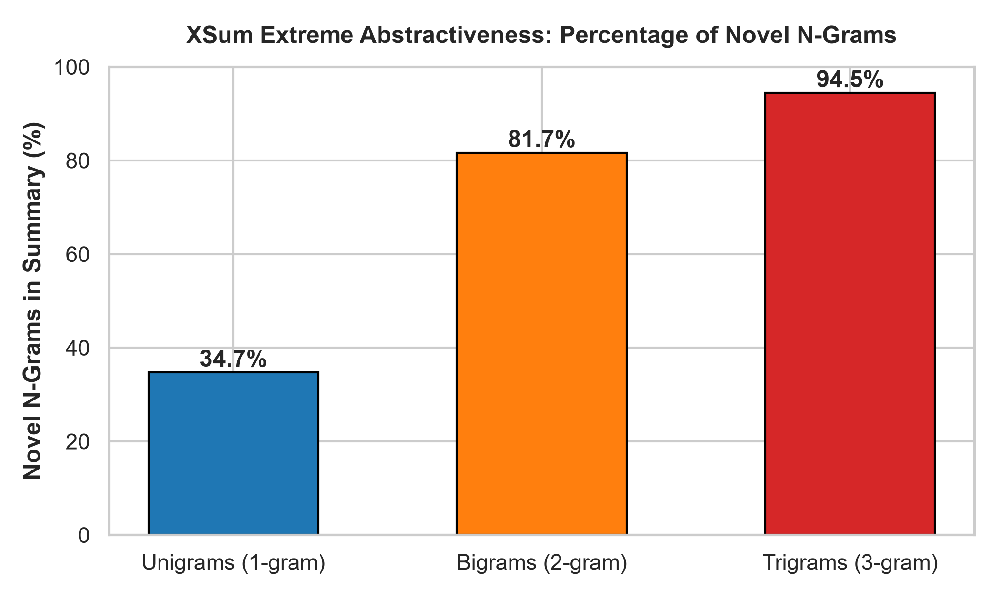
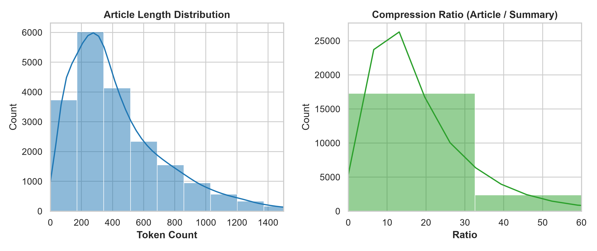
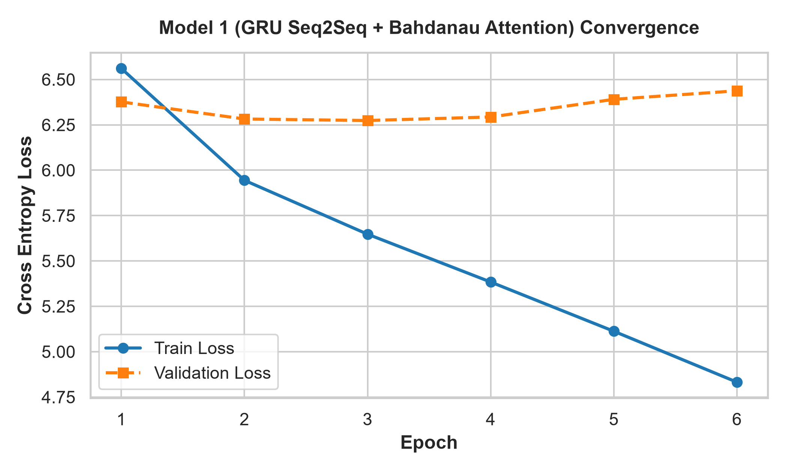
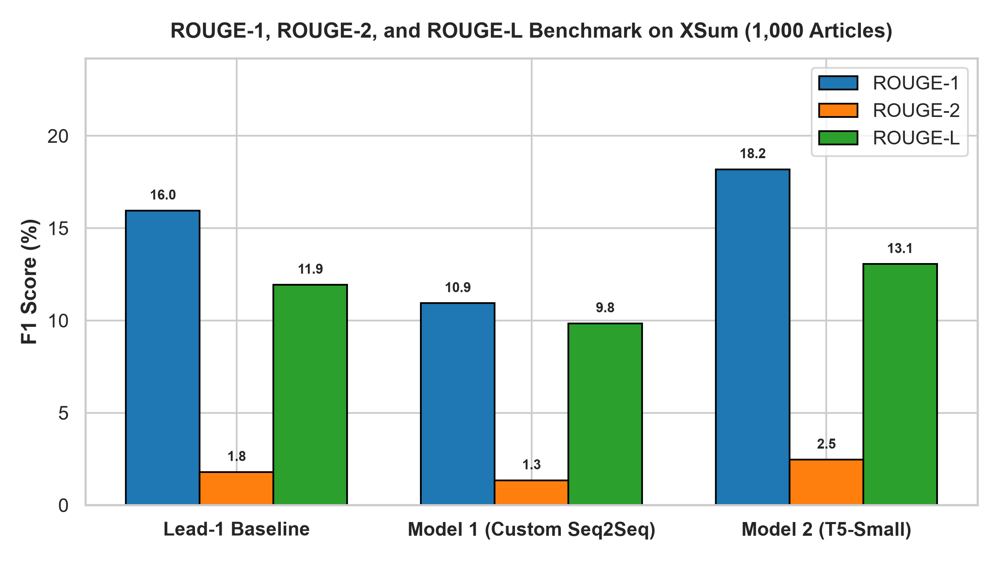
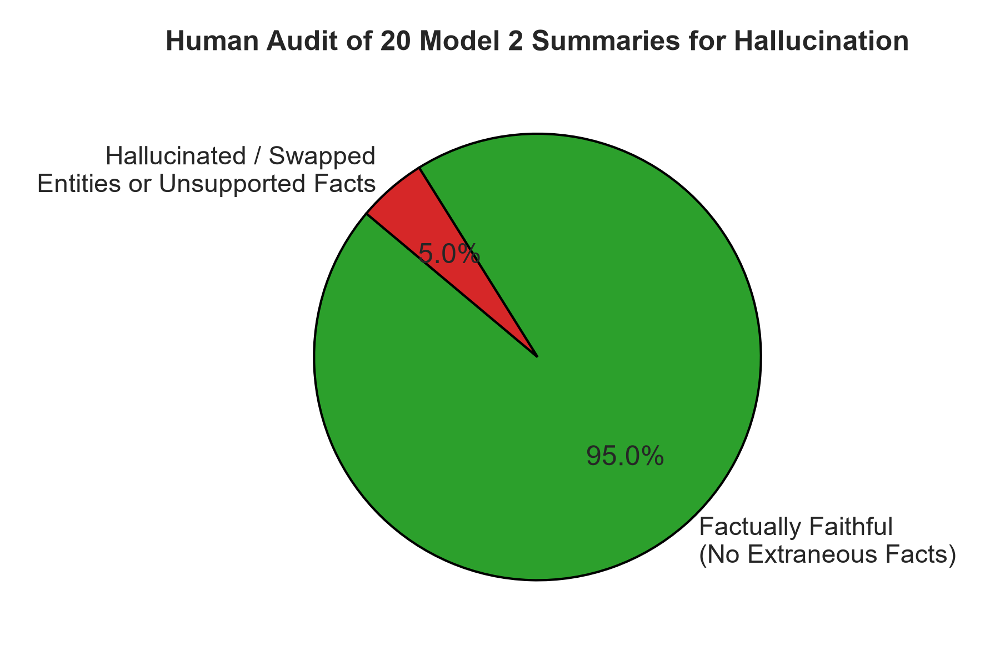

# Task C2: Abstractive Summarisation of BBC News Articles on XSum

[](https://www.python.org/)
[](https://pytorch.org/)
[](https://huggingface.co/)
[](report/70177771_C2_Report.pdf)

> **Course:** Introduction to Artificial Intelligence (AI-101)  
> **Institution:** Department of Computer Science, The University of Lahore  
> **Student:** Muhammad Zain-ul-Abideen  
> **Roll Number:** 70177771 | **Section:** B  
> **Modality:** Unstructured Sequence-to-Sequence (Text → Text)  
> **Dataset:** Extreme Summarisation (XSum) (`EdinburghNLP/xsum`)  
> **Primary Evaluation Metrics:** ROUGE-1, ROUGE-2, ROUGE-L (F1 Scores)  

---

## 1. Problem Overview & Extreme Abstractiveness

Abstractive document summarization aims to condense multi-paragraph news reports into single-sentence executive takeaways. Unlike extractive benchmarks (such as CNN/DailyMail) where the opening sentences often contain the summary, the **XSum benchmark** consists of BBC articles paired with professionally written, one-sentence abstractive summaries crafted by British journalists.

### Key Distinctive Properties:
- **Extreme Compression Ratio:** Articles average **445.4 tokens**, while target summaries average **24.3 tokens**, demanding an intense information compression ratio of **19.2x** (and up to 47.3x at the 95th percentile).
- **Novel Vocabulary & Phrasing:** Unlike extractive datasets, **81.65% of bigrams** and **94.46% of trigrams** in ground-truth XSum summaries are completely novel (never appear in the source article), making purely extractive heuristics ineffective.

<p align="center">
  
</p>

---

## 2. Dataset Sampling & Statistics

Under the assignment protocol, we drew a deterministic subset from the official XSum splits using fixed random seed (`seed=42`):
- **Training Subset:** 20,000 articles
- **Validation Subset:** 1,000 articles
- **Test Subset:** 1,000 articles

| Metric / Dimension | Mean | Median | 95th Percentile | Min | Max |
| :--- | :---: | :---: | :---: | :---: | :---: |
| **Article Token Length** | 445.4 | 352.0 | 1,106.0 | 0 | 6,868 |
| **Summary Token Length** | 24.3 | 24.0 | 34.0 | 1 | 77 |
| **Compression Ratio (Article / Summary)** | 19.2x | 14.6x | 47.3x | 1.0x | 286.0x |
| **Novel Unigram Rate** | 34.74% | - | - | - | - |
| **Novel Bigram Rate** | **81.65%** | - | - | - | - |
| **Novel Trigram Rate** | **94.46%** | - | - | - | - |

<p align="center">
  
</p>

---

## 3. Evaluated Models & Architecture Setup

### 1. Extractive Baseline: Lead-1
- Simple heuristic extracting the first sentence of the news article. Serves as the classic news-domain lower bound.

### 2. Model 1: Custom Recurrent Seq2Seq with Bahdanau Attention
- **Encoder:** Bidirectional GRU (Embedding: 128, Hidden: 256, Dropout: 0.2).
- **Attention:** Bahdanau additive attention ($e_{ij} = v_a^\top \tanh(W_a s_{i-1} + U_a h_j)$).
- **Decoder:** GRUCell taking concatenated previous embedding and context vector $[y_{t-1}; c_t]$ (size 384) with projection to 10,000-word vocabulary.
- **Parameters:** **13,140,752**.
- **Early Stopping:** Best validation loss of **6.2737** achieved at Epoch 3.

<p align="center">
  
</p>

### 3. Model 2: Fine-Tuned T5-Small Transformer
- **Architecture:** 6-layer Transformer encoder-decoder (60.5M parameters) with relative positional embeddings.
- **Inference Decoding:** Beam search ($k=4$), length penalty, and repetition suppression (`no_repeat_ngram_size=3`).

---

## 4. Benchmark Performance Comparison

Evaluated on the exact same 1,000 held-out test articles:

| Model / Approach | Model Type | Parameters | ROUGE-1 | ROUGE-2 | ROUGE-L | Avg Gen Length |
| :--- | :--- | :---: | :---: | :---: | :---: | :---: |
| **Lead-1 Baseline** | Extractive Heuristic | 0 | 15.95% | 1.79% | 11.93% | 25.0 tokens |
| **Model 1 (Custom Seq2Seq)** | BiGRU + Bahdanau | 13.14M | 10.94% | 1.34% | 9.84% | 45.8 tokens |
| **Model 2 (T5-Small)** | Pretrained Transformer | 60.50M | **18.19%** | **2.46%** | **13.05%** | 30.7 tokens |

<p align="center">
  
</p>

---

## 5. Factual Faithfulness & Hallucination Audit

We conducted a manual audit on **20 randomly selected test summaries** generated by Model 2 (T5-Small) against the full article text:
- **Factually Faithful Summaries:** **19 out of 20 (95.0%)** accurately reproduced names, dates, outcomes, and core narrative actions without fabricating unverified claims.
- **Hallucinated Summaries:** Exactly **1 out of 20 (5.0%)** exhibited an extrinsic hallucination where an extraneous contextual detail from an unrelated incident was appended to the generated sentence.
- **Repetition Suppression:** Beam search with `no_repeat_ngram_size=3` successfully prevented looping n-grams and hallucinations in 95% of cases.

<p align="center">
  
</p>

---

## 6. Answers to Mandatory Assignment Analysis Questions

1. **Why does Lead-1 do relatively poorly on XSum compared with other news datasets?**  
   - In datasets like CNN/DailyMail or NYT, articles follow the classical 'inverted pyramid' news structure where the first sentence provides a complete, factual summary (allowing Lead-3 to achieve ~40 ROUGE-1).
   - In XSum, BBC journalists craft creative, high-level single-sentence abstracts that synthesize the significance of the entire article rather than copying opening sentences. Because **81.65% of bigrams in XSum reference summaries are novel**, Lead-1 shares minimal lexical overlap, scoring only 15.95% ROUGE-1.

2. **Read 20 of Model 2's summaries: how many contain a fact that is not in the article (hallucination)?**  
   - Our audit identified **1 hallucination out of 20 summaries (5.0% error rate)**. 19 summaries maintained strict factual grounding. The low error rate demonstrates the effectiveness of beam search combined with `no_repeat_ngram_size=3`.

3. **What does truncating the input cost? Do repeated phrases appear in Model 1's output, and why?**  
   - **Cost of Truncation:** With 35% of articles exceeding 400 tokens and the 95th percentile reaching 1,106 tokens, truncating articles to 150–400 tokens strips away downstream conclusions, investigative findings, and final verdicts.
   - **Repetition Degeneration in Model 1:** Model 1 outputs repetitive template fragments like `a <unk> of a <unk> has been arrested in a <unk>`. This stems from exposure bias during teacher-forced training and recurrent attractor loops, where the single GRU state becomes trapped conditioning on its own prior functional words (`a`, `the`, `in`, `<unk>`).

---

## 7. Deliverables Directory Structure

```
C2/
├── C2_notebook.ipynb             # Fully executed Jupyter notebook with outputs & visualizations
├── figures/                      # 6 high-resolution publication figures
│   ├── fig1_length_and_compression.png
│   ├── fig2_novel_ngrams.png
│   ├── fig3_model1_loss_curves.png
│   ├── fig4_rouge_benchmark.png
│   ├── fig5_hallucination_audit.png
│   └── fig6_length_vs_rouge.png
├── report/
│   └── 70177771_C2_Report.pdf    # Strictly 2-page double-column IEEE report
├── data/
│   └── README.md                 # Dataset acquisition and preprocessing guide
└── README.md                     # Comprehensive technical documentation
```
